<p align="center">
  
</p>

<h1 align="center">Radial Menu</h1>

<p align="center">
  Menu tròn thay cho menu chuột phải của Windows.<br>
  Nhấn giữ chuột phải, kéo nhẹ về một hướng, nhả tay là lệnh chạy. Mỗi ứng dụng một bộ lệnh riêng.
</p>

<p align="center">
  <a href="https://github.com/wwwxadieu/RadialMenu/releases/latest"></a>
  
  <a href="LICENSE"></a>
</p>

<p align="center">
  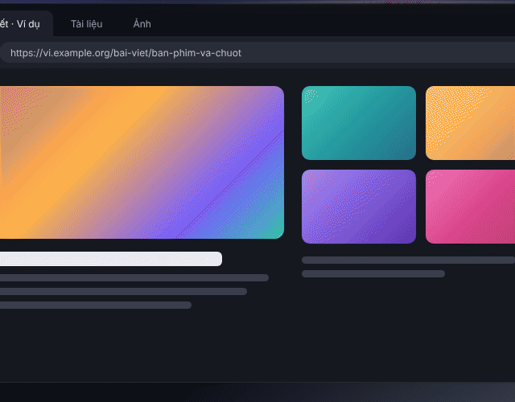
</p>

## Giới thiệu

Menu chuột phải của Windows dài, nhiều tầng, và giống hệt nhau ở mọi nơi. Radial Menu đặt 8 lệnh bạn hay dùng nhất thành một vòng tròn ngay dưới con trỏ. Bạn không phải đọc danh sách hay nhắm vào một dòng chữ nhỏ: chỉ cần nhớ hướng. Dùng vài lần là tay tự nhớ: kéo lên là tab mới, kéo xuống là đóng tab, kéo sang trái là quay lại.

Bộ lệnh tự đổi theo ứng dụng dưới con trỏ: trình duyệt có bộ lệnh của trình duyệt, File Explorer có bộ lệnh làm việc với file, trình soạn code có bộ lệnh của trình soạn code. Ứng dụng nào chưa có bộ riêng thì dùng bộ Mặc định. Mọi lệnh đều sửa được trong cửa sổ cài đặt, không cần đụng vào file cấu hình.

Nhấp chuột phải bình thường (không kéo) vẫn ra menu gốc của Windows, nên bạn không mất gì cả.

## Tính năng

- **Cử chỉ tự nhiên:** nhấn giữ chuột phải, kéo khoảng 10 px là menu mở ngay tại chỗ nhấn. Nhả ở một góc để chạy lệnh, nhả ở giữa để huỷ.
- **Bộ lệnh theo từng ứng dụng:** tự nhận ra ứng dụng nằm dưới con trỏ, kể cả cửa sổ đang nằm sau. Desktop và cửa sổ File Explorer có bộ lệnh khác nhau dù cùng là `explorer.exe`.
- **Thư viện lệnh kéo thả:** hơn 60 lệnh soạn sẵn (Sao chép, Dán, Tab mới, Chụp vùng, Phát/Dừng nhạc…). Kéo một lệnh thả vào góc trên hình menu là xong, không cần tự nhập phím tắt.
- **6 loại hành động:** gửi phím tắt, chạy chương trình, mở URL hoặc thư mục, gõ một đoạn văn bản (có dấu tiếng Việt), chạy chuỗi nhiều bước, mở cài đặt của Radial Menu.
- **Chọn đúng thứ dưới con trỏ:** với Đổi tên, Xoá, Tới định nghĩa…, app click vào chỗ bạn nhấn trước rồi mới gửi phím, nên lệnh luôn áp vào đúng file hay đúng chữ.
- **Góc Dán thông minh:** clipboard trống thì góc Dán mờ đi và không chọn được.
- **Kính mờ thật:** nội dung phía sau menu được làm mờ như tấm kính, cùng hiệu ứng mở và đóng mượt.
- **Icon thật của ứng dụng** ở giữa menu, để biết chắc mình đang dùng bộ lệnh nào.
- **Màu theo ý bạn:** tông sáng/tối, 5 màu nhấn có sẵn và bộ chọn màu tự do (kéo chọn, nhập mã HEX hoặc lấy màu ngay trên màn hình). Kích thước menu 80–140%.
- **Biết lúc nào nên đứng ngoài:** không mở trong game hay video toàn màn hình, trong ứng dụng chạy quyền Admin, hoặc trong các ứng dụng bạn liệt kê. Giữ <kbd>Shift</kbd> khi nhấn là luôn ra menu gốc.
- **Đổi ý giữa chừng:** kéo vụt ra xa là menu tự đóng, hoặc bấm <kbd>Esc</kbd>.
- **Hướng dẫn ngay trong app:** mục Hướng dẫn trong cửa sổ cài đặt, có minh hoạ cử chỉ, bảng thao tác, mẹo và cách xử lý khi menu không mở.
- **Sao lưu một chạm:** xuất toàn bộ cài đặt và bộ lệnh ra một file JSON, nhập lại trên máy khác.
- **Nhẹ:** viết bằng Rust và Tauri; bộ cài khoảng 1,3 MB.

| Tông tối | Tông sáng |
| --- | --- |
| 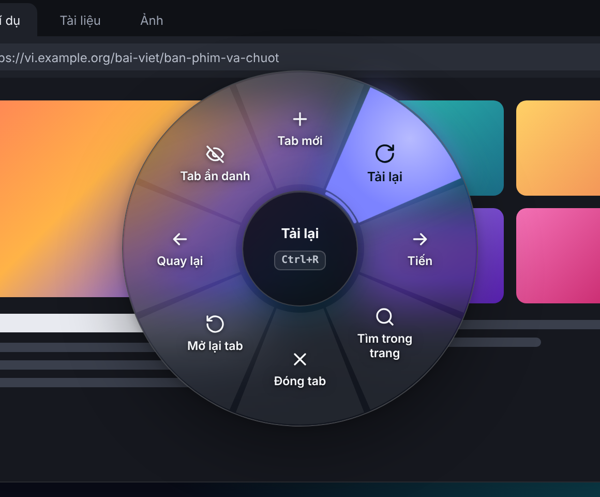 | 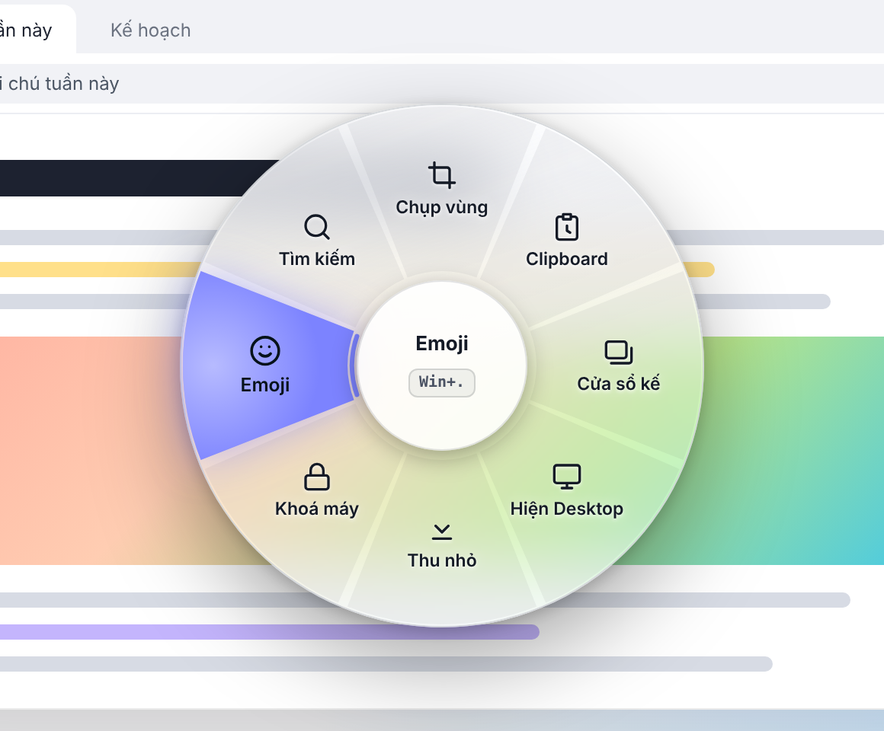 |
| **Clipboard trống: góc Dán mờ đi** | **Icon thật của ứng dụng ở giữa** |
| 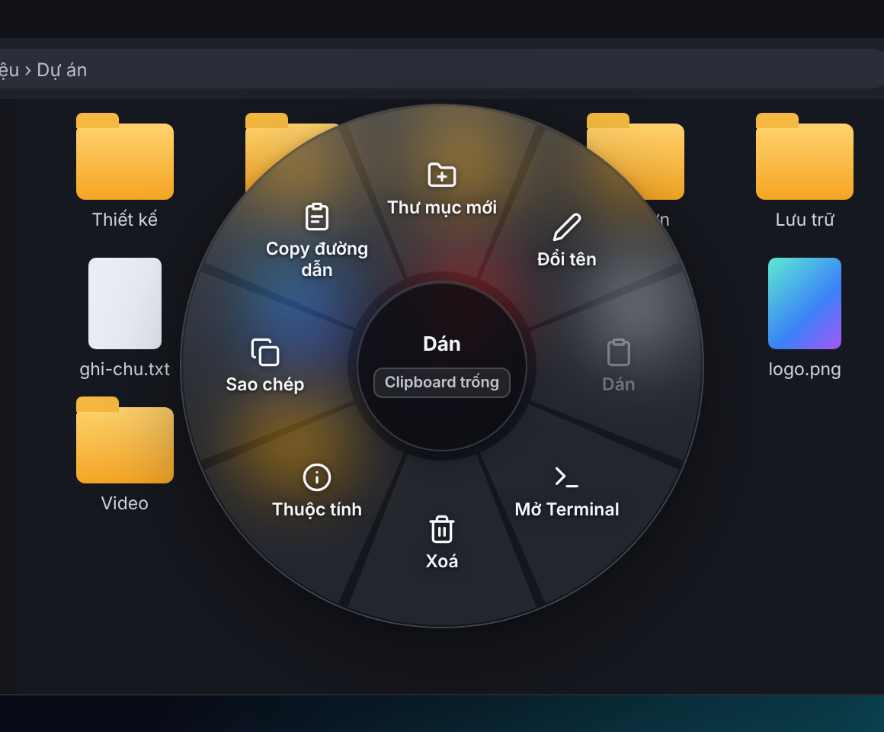 | 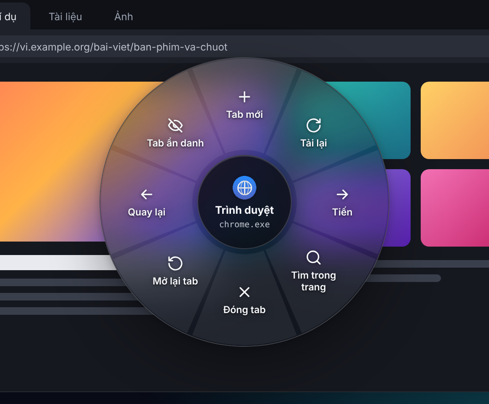 |

## Tải về và cài đặt

1. Vào trang [Releases](https://github.com/wwwxadieu/RadialMenu/releases/latest) và tải file `RadialMenu_…_x64-setup.exe` ở mục **Assets** (số ở giữa là phiên bản).
2. Chạy file vừa tải. Bộ cài hỏi quyền Admin vì cài vào `C:\Program Files\Radial Menu` cho mọi tài khoản trên máy.
3. Bộ cài chưa được ký số, nên Windows SmartScreen có thể hiện cảnh báo. Chọn **More info › Run anyway** để tiếp tục.
4. Cài xong, Radial Menu chạy dưới khay hệ thống và mở cửa sổ cài đặt.

**Yêu cầu:** Windows 10 (bản 2004 trở lên) hoặc Windows 11, 64-bit. Cần WebView2: Windows 11 có sẵn, còn Windows 10 thì bộ cài tự tải nếu thiếu.

**Gỡ cài đặt:** Settings › Apps › Installed apps › Radial Menu › Uninstall. Cài đặt và bộ lệnh của bạn vẫn nằm trong `%APPDATA%\com.mrbeohp.radialmenu\`, xoá thư mục đó nếu muốn gỡ sạch.

## Hướng dẫn sử dụng

### Mở menu và chọn lệnh

| Thao tác | Kết quả |
| --- | --- |
| Nhấn giữ chuột phải, kéo nhẹ | Menu mở tại chỗ nhấn |
| Kéo về một hướng rồi nhả | Chạy lệnh của góc đó |
| Nhả ở giữa menu, bấm <kbd>Esc</kbd>, hoặc bấm nút chuột khác | Đóng menu, không làm gì |
| Kéo vụt ra xa khỏi menu | Menu tự đóng (đổi ý giữa chừng) |
| Nhấp chuột phải bình thường, không kéo | Menu chuột phải gốc của Windows |
| Giữ <kbd>Shift</kbd> khi nhấn chuột phải | Luôn ra menu gốc |

Thao tác nhanh nhất là **nhấn, vụt, nhả**: không cần đợi menu hiện hết, cứ vụt về hướng muốn chọn rồi nhả tay.

### Bộ lệnh có sẵn

Lần chạy đầu, app tạo sẵn 5 bộ lệnh. Hướng đọc theo la bàn: Bắc là kéo lên, Đông là kéo sang phải.

| Bộ lệnh | Dùng cho | Bắc | Đông Bắc | Đông | Đông Nam | Nam | Tây Nam | Tây | Tây Bắc |
| --- | --- | --- | --- | --- | --- | --- | --- | --- | --- |
| **Trình duyệt** | Chrome, Edge, Firefox, Brave, Opera, Vivaldi | Tab mới | Tải lại | Tiến | Tìm trong trang | Đóng tab | Mở lại tab | Quay lại | Tab ẩn danh |
| **File Explorer** | Cửa sổ File Explorer | Thư mục mới | Đổi tên | Dán | Mở Terminal | Xoá | Thuộc tính | Sao chép | Copy đường dẫn |
| **Desktop** | Màn hình nền | Thư mục mới | Làm mới | Dán | Cài đặt Radial Menu | Xoá | Thuộc tính | Sao chép | Copy đường dẫn |
| **Code editor** | VS Code, Cursor, Windsurf, VSCodium | Định dạng | Tới định nghĩa | Mở file nhanh | Terminal | Comment | Đổi tên biến | Chạy | Chia đôi |
| **Mặc định** | Mọi ứng dụng khác | Chụp vùng | Clipboard | Cửa sổ kế | Hiện Desktop | Thu nhỏ | Khoá máy | Emoji | Tìm kiếm |

### Mở cửa sổ cài đặt

Có ba cách: bấm icon Radial Menu dưới khay hệ thống, chọn góc **Cài đặt Radial Menu** (kéo xuống chéo phải) khi đang ở màn hình nền, hoặc mở lại Radial Menu từ Start menu.

### Sửa một bộ lệnh

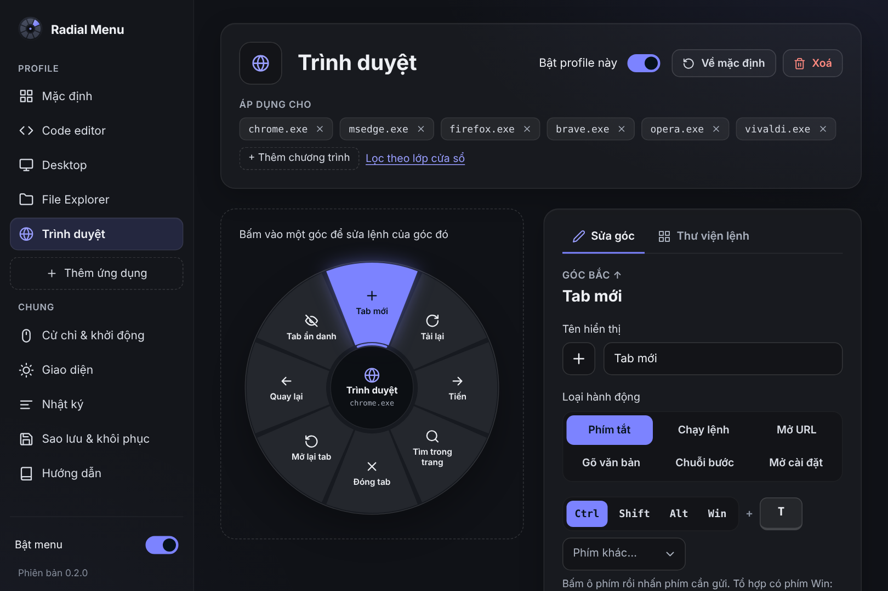

1. Chọn bộ lệnh ở cột bên trái.
2. Cách nhanh nhất: mở thẻ **Thư viện lệnh**, kéo một lệnh có sẵn và thả vào một góc trên hình menu. Bấm vào một lệnh thì lệnh đó được gán cho góc đang chọn.
3. Muốn tự đặt lệnh: bấm vào một góc trên hình menu (hoặc dùng phím mũi tên), đặt tên hiển thị, chọn icon, chọn loại hành động rồi nhập nội dung.
4. Bấm **Lưu** (hoặc <kbd>Ctrl</kbd>+<kbd>S</kbd>). Lỗi nào cũng được báo rõ ở góc nào; bấm **Huỷ thay đổi** để quay lại.

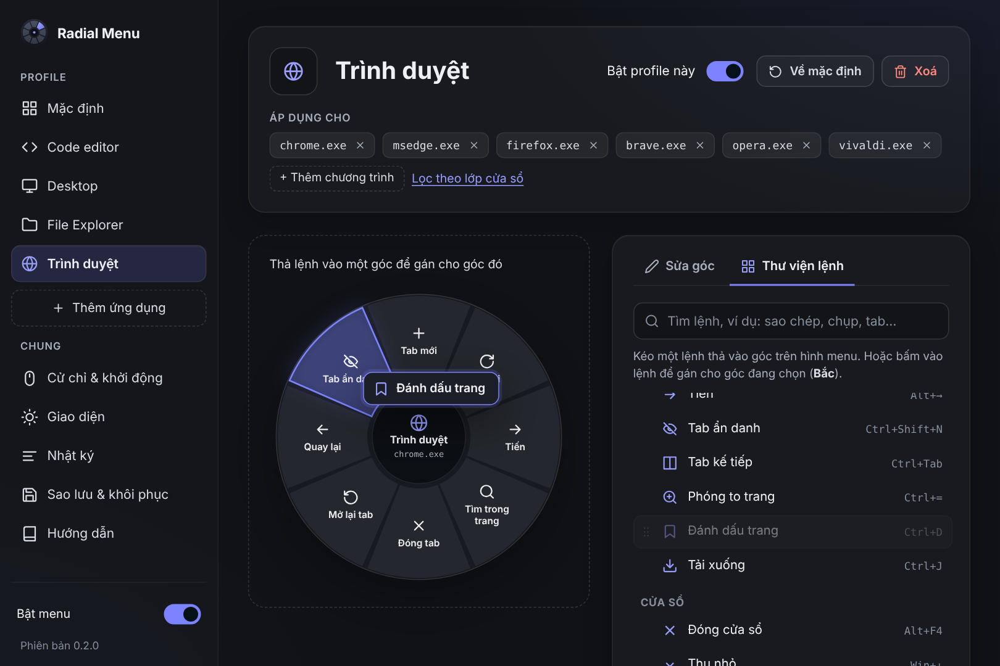

| Loại hành động | Bạn nhập | Ví dụ |
| --- | --- | --- |
| **Phím tắt** | Bật các nút Ctrl/Shift/Alt/Win rồi bấm vào ô phím và nhấn phím cần gửi | Ctrl+Shift+T |
| **Chạy lệnh** | Chương trình, tham số, thư mục chạy | `wt -d %DESKTOP%` |
| **Mở URL** | Địa chỉ web, file hoặc thư mục | `https://github.com`, `%DOWNLOADS%` |
| **Gõ văn bản** | Đoạn chữ sẽ được gõ vào (có xuống dòng, có dấu) | Trân trọng, … |
| **Chuỗi bước** | Nhiều bước chạy lần lượt: phím tắt, gõ chữ, chờ, chạy lệnh, mở URL | Alt+D → gõ `wt -d .` → Enter |
| **Mở cài đặt** | Không cần nhập gì | Mở cửa sổ cài đặt này |

Mỗi góc còn có hai tuỳ chọn:

- **Click vào chỗ vừa nhấn trước khi chạy:** dùng cho lệnh cần chọn đúng thứ dưới con trỏ như Đổi tên, Xoá, Tới định nghĩa.
- **Chỉ bật khi clipboard có dữ liệu:** góc mờ đi khi clipboard trống. Góc gửi Ctrl+V tự bật sẵn tuỳ chọn này.

Trong chương trình, tham số và địa chỉ có thể dùng biến môi trường (`%USERPROFILE%`…) và ba thư mục đặc biệt `%DESKTOP%`, `%DOCUMENTS%`, `%DOWNLOADS%` (đúng cả khi các thư mục này đã chuyển sang OneDrive).

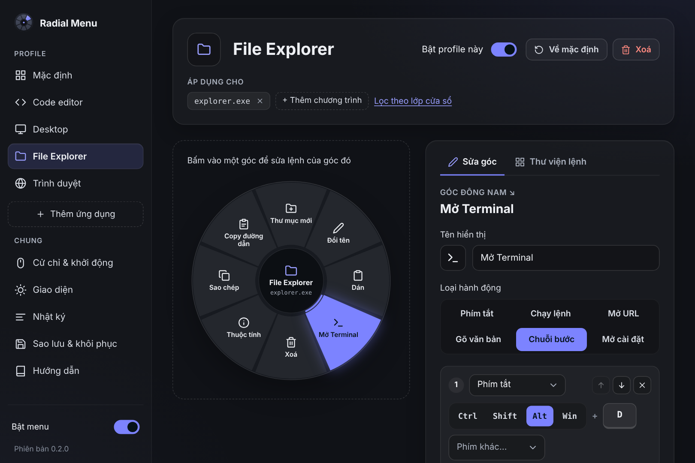

### Thêm bộ lệnh cho ứng dụng khác

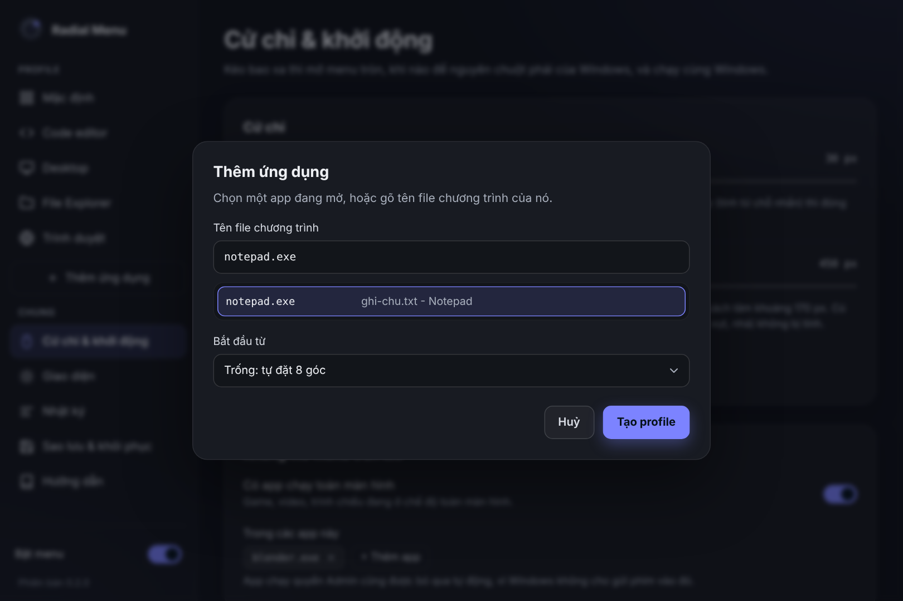

Bấm **Thêm ứng dụng**, chọn một ứng dụng trong danh sách đang mở (hoặc gõ tên file như `notepad.exe`), chọn bắt đầu từ bộ trống hay sao chép một bộ có sẵn, rồi sửa các góc như trên. Không biết tên file của một ứng dụng thì mở Task Manager › Details để xem.

Một bộ lệnh có thể áp dụng cho nhiều chương trình cùng lúc. Bấm **Lọc theo lớp cửa sổ** nếu chỉ muốn áp dụng cho một loại cửa sổ của chương trình đó (như cách bộ Desktop tách khỏi File Explorer).

### Cử chỉ & khởi động

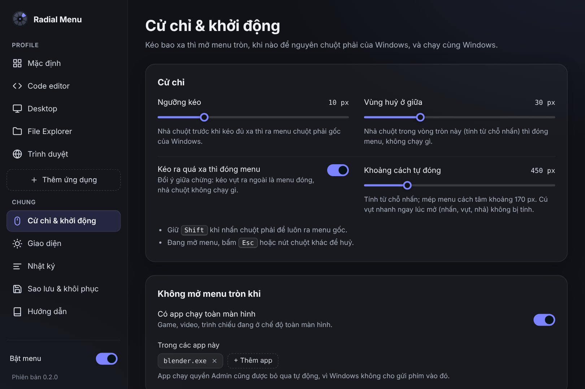

- **Ngưỡng kéo:** kéo bao xa thì menu mở. Nhả trước ngưỡng này là ra menu gốc.
- **Vùng huỷ ở giữa:** nhả trong vòng tròn này thì không chạy gì.
- **Kéo ra quá xa thì đóng menu** và **khoảng cách tự đóng** (mặc định 450 px). Cú vụt nhanh ngay lúc mở không bị tính.
- **Không mở menu tròn khi:** có ứng dụng chạy toàn màn hình, hoặc trong các ứng dụng bạn liệt kê (mặc định có Blender, vốn dùng chuột phải theo cách riêng).
- **Chạy cùng Windows:** tự mở khi đăng nhập và nằm im dưới khay.

### Giao diện

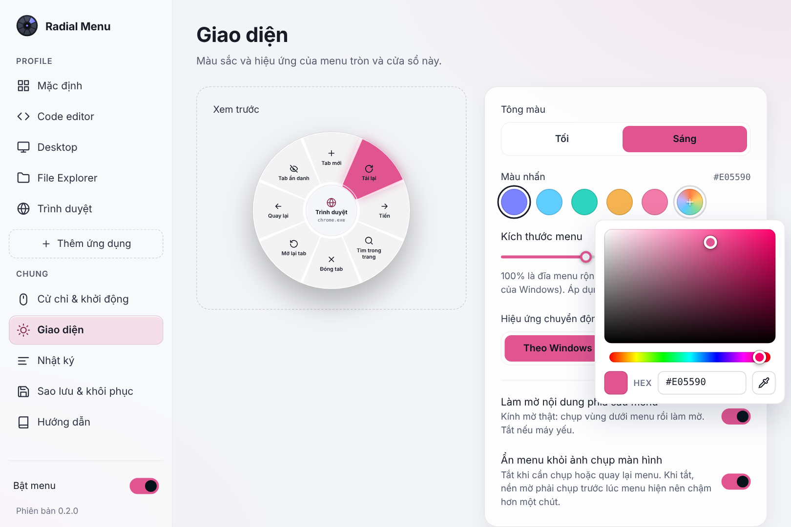

Chọn tông tối hoặc sáng, màu nhấn và kích thước menu. Ngoài 5 màu có sẵn, bấm ô cầu vồng để mở bộ chọn màu: kéo trong ô màu và thanh sắc màu, gõ mã HEX, hoặc bấm biểu tượng ống hút để lấy một màu bất kỳ trên màn hình. Màu đổi ngay khi bạn kéo. Hiệu ứng chuyển động có thể theo cài đặt của Windows, luôn bật hoặc tắt hẳn. Máy yếu thì tắt **Làm mờ nội dung phía sau menu**. Tắt **Ẩn menu khỏi ảnh chụp màn hình** nếu bạn cần chụp hoặc quay lại menu.

### Hướng dẫn trong app

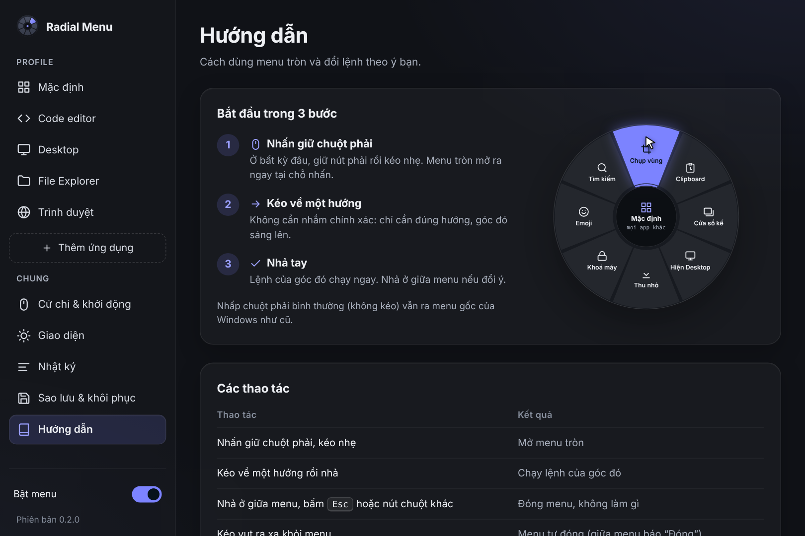

Mục **Hướng dẫn** ở cuối cột bên trái tóm tắt cách dùng: ba bước mở menu có hình minh hoạ chạy thử, bảng thao tác, cách đổi lệnh, mẹo dùng nhanh và cách xử lý khi menu không mở.

### Nhật ký, sao lưu và khay hệ thống

- **Nhật ký** ghi lại mỗi lần menu mở, lệnh nào đã chạy và vì sao một lần nhấn được để cho Windows. Hữu ích khi một lệnh không chạy như ý.
- **Sao lưu & khôi phục:** xuất toàn bộ cài đặt và bộ lệnh ra một file JSON (lưu vào thư mục Downloads), nhập lại từ file, hoặc đưa 5 bộ lệnh có sẵn về như lúc mới cài.
- **Khay hệ thống:** chuột phải vào icon để mở cài đặt, tạm dừng menu tròn, mở thư mục cấu hình, nạp lại cấu hình hoặc thoát.

## Câu hỏi thường gặp

**Menu không mở trong một ứng dụng.** Có thể ứng dụng đó đang chạy quyền Admin (Windows không cho gửi phím vào đó, nên Radial Menu tự đứng ngoài), đang ở chế độ toàn màn hình, hoặc nằm trong danh sách bỏ qua. Trang Nhật ký ghi rõ lý do.

**Tôi muốn nhấp chuột phải như cũ.** Nhấp mà không kéo vẫn ra menu gốc. Giữ <kbd>Shift</kbd> khi nhấn để chắc chắn. Muốn tắt hẳn một lúc thì gạt **Bật menu** ở góc dưới cửa sổ cài đặt, hoặc chọn **Tạm dừng** ở khay.

**Chụp màn hình không thấy menu.** Mặc định menu được ẩn khỏi ảnh chụp để làm mờ nền nhanh hơn. Tắt **Ẩn menu khỏi ảnh chụp màn hình** trong trang Giao diện.

**Icon ở giữa menu không đúng với một số ứng dụng.** Các ứng dụng kiểu UWP (Settings, Calculator…) chạy trong một tiến trình chung của Windows nên có thể hiện icon chung chung.

**Khoá máy bằng Win+L không được.** Windows chặn gửi Win+L bằng phần mềm, nên bộ Mặc định dùng lệnh khoá máy của hệ thống thay cho phím tắt.

## Cấu hình bằng file

Cài đặt và bộ lệnh nằm trong `%APPDATA%\com.mrbeohp.radialmenu\` (mỗi bộ lệnh là một file trong thư mục `profiles`). Cửa sổ cài đặt làm được mọi thứ, nhưng nếu thích sửa tay thì xem định dạng trong [docs/DEVELOPMENT.md](docs/DEVELOPMENT.md#cấu-hình), rồi bấm **Nạp lại** ở khay hoặc trang Sao lưu & khôi phục.

## Build từ mã nguồn

Cần Rust (toolchain MSVC, 1.90 trở lên), Visual Studio Build Tools (Desktop development with C++) và Node.js 20.19 trở lên.

```powershell
git clone https://github.com/wwwxadieu/RadialMenu.git
cd RadialMenu
npm install
npm run tauri dev
```

Hoặc bấm đúp `build.cmd` để build bản debug và chạy thử, `build-release.cmd` để tạo bộ cài. Cấu trúc mã nguồn, cách hook chuột hoạt động và cách chạy test có trong [docs/DEVELOPMENT.md](docs/DEVELOPMENT.md).

## Giấy phép

Radial Menu là phần mềm tự do theo giấy phép [GNU GPL v3.0](LICENSE): bạn được dùng, sửa và phân phối lại, với điều kiện bản phân phối lại cũng mở mã nguồn theo cùng giấy phép.
