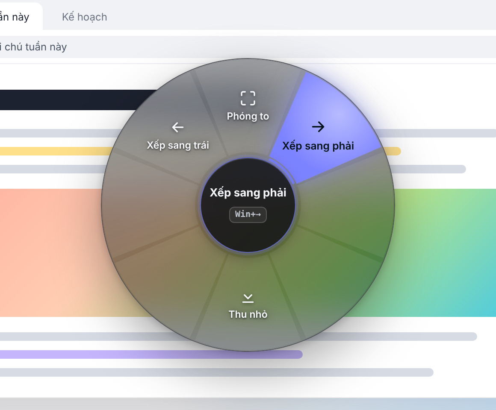

Bản 0.3.0 thêm menu con để có nhiều hơn 8 lệnh, lệnh Mở bằng cho file trong File Explorer, và từ bản này Radial Menu tự báo khi có bản mới.

## Có gì mới

- **Menu con.** Đổi loại của một góc thành "Menu con" để chứa thêm tối đa 8 lệnh. Khi dùng, kéo vụt qua mép menu ở góc có dấu › là vòng lệnh đổi sang menu con ngay tại chỗ, kéo tiếp rồi nhả để chạy. Hoặc nhả chuột ở góc đó, rồi di chuột và bấm vào lệnh cần chạy.
- **Mở bằng (Open with).** Loại lệnh mới mở file đang chọn trong File Explorer hoặc trên Desktop bằng chương trình bạn chỉ định (VS Code, Notepad, Photoshop…), hoặc hiện hộp thoại "Open with" của Windows để chọn app. Thư viện lệnh có sẵn menu con "Mở bằng" gồm Chọn app, VS Code, Notepad và Paint.
- **Tự cập nhật.** App tự kiểm tra bản mới trên GitHub mỗi ngày và báo trong cửa sổ cài đặt lẫn khay hệ thống. Bấm "Cập nhật ngay" là tải, kiểm tra chữ ký rồi cài; cài xong app tự mở lại. Không bao giờ tự cài khi chưa hỏi, và tắt được trong Cử chỉ & khởi động.
- **Nút "Kiểm tra bản mới"** ở góc dưới cột bên trái của cửa sổ cài đặt.
- Thư viện lệnh kéo thả được vào cả menu con.
- Cập nhật không còn làm mất tuỳ chọn "Chạy cùng Windows".
